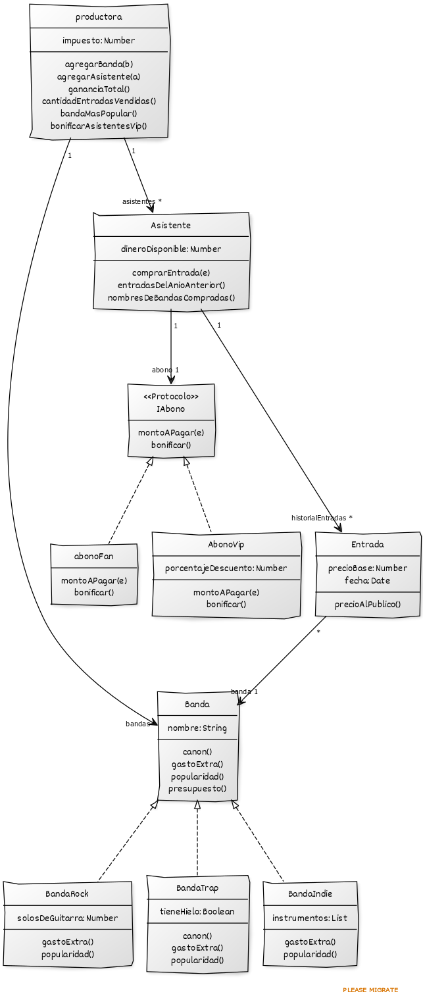

# Paradigmas-de-Programación-TP-Individual-de-Objetos

## Diagrama de Clases

---------------------------------------------------------------------------

## Justificación y conceptos utilizados

* **Abonos:** Separe la lógica del cálculo del precio a pagar en el objeto abonoFan y AbonoVip para evitar condicionales adentro de la clase Asistente para poder agregar nuevos tipos de abono a futuro sin modificar la estructura de Asistente.
* **Abono Fan como Objeto separado:** Como el abono Fan no necesita mantener un estado mutable particular por asistente, se modeló como un "well known object" y AbonoVip se creo como clase porque cada asistente tiene un porcentaje de descuento propio que varía con las bonificaciones.
* **Superclase Banda:** Cree la clase Banda para definir el método presupuesto. Las subclases BandaRock, BandaTrap y BandaIndie reutilizan la estructura general y redefinen el cálculo de sus gastos extras, popularidad o canon.
* **Validación de cobro:** La validación de saldo positivo previa a la compra de una entrada se realiza interrumpiendo la ejecución con self.error. Esto evita el cobro cuando es debido.

1. **Self, Polimorfismo, Encapsulamiento y Responsabilidad:**
   * Polimorfismo entre los abonos abonoFan y AbonoVip al responder a montoAPagar y bonificar, y entre las distintas variantes de Banda. El Asistente encapsula su saldo y delega la responsabilidad del cálculo de cobro en su abono.

2. **Composición, herencia, Clases Abstractas y Redefinición:**
   * Se utiliza composición entre Asistente y Abono para flexibilizar la estrategia de descuento y permitir bonificaciones. Se utiliza herencia con la clase abstracta Banda, donde BandaRock, BandaTrap y BandaIndie aplican redefinición de los métodos gastoExtra, popularidad y canon.

3. **Colecciones y Testing:**
   * Uso declarativo de bloques sobre colecciones mediante mensajes de orden superior  en productora y Asistente. Verificación completa del comportamiento y casos de borde en tests.wtest mediante assert.equals y assert.throwsExceptionWithMessage.

4. **Manejo de Errores y Excepciones:**
   * Uso self.error para lanzar excepciones de dominio cuando un asistente sin saldo intenta comprar una entrada o al consultar la banda más popular sin bandas registradas, interrumpiendo el flujo antes de generar un efecto secundario.

5. **Clases, well known object y Diagrama de Clases:**
   * Modelado de entidades como clases separadas (Asistente, Entrada, Banda) conviviendo con objetos bien conocidos (productora, abonoFan), documentados estructuralmente con roles en el diagrama de clases.